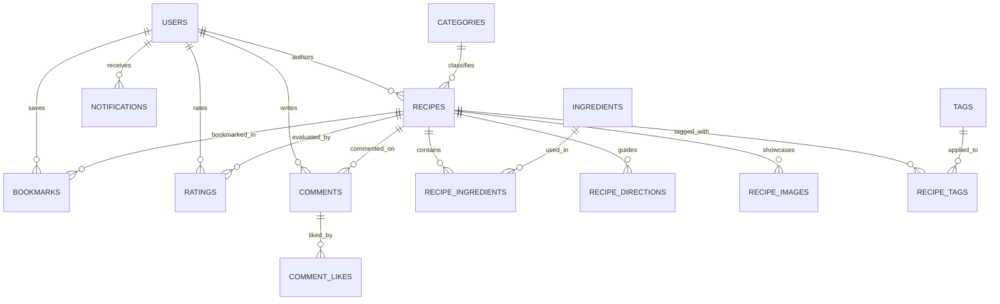

<div align="center">

# 🍳 Smart Recipes: Intelligent Culinary Discovery & Recipe Management Platform

### Next-Gen Ingredient Matching, Community Gastronomy Hub & Multi-Tier Admin Moderation

**Transforming Kitchen Scraps into Gourmet Meals — Powered by Multi-Factor Relevance Scoring**

[](#system-architecture)
[](#database-schema--seed-data)
[](#docker-deployment)
[](#technology-stack-specifications)
[](https://smart-recipes-l8mu.onrender.com/)
[](#system-architecture)
[](#security--production-readiness)
[](#license--author)

<br/>

**[Live Demo](#live-demo--preview) · [Executive Overview](#executive-overview) · [Key Features](#key-features) · [Matching Engine](#smart-ingredient-search-engine) · [RBAC](#role-based-access-control-rbac) · [System Architecture](#system-architecture) · [Quick Start](#quick-start) · [Docker Deployment](#docker-deployment) · [REST API](#restful-api-directory) · [Troubleshooting](#troubleshooting--faq)**

<br/>

```bash
git clone https://github.com/hoangcamanh/smart_recipes.git
```

</div>

> [!IMPORTANT]
> **Production & Live Evaluation Notice**:
> - **Cloud Live Deployment**: The platform is live and publicly accessible at **[https://smart-recipes-l8mu.onrender.com/](https://smart-recipes-l8mu.onrender.com/)**.
> - **Pre-seeded Evaluation Credentials**: Instant demo accounts with both Administrator and Standard User privileges are available in the [Role-Based Access Control](#role-based-access-control-rbac) table.
> - **Multi-Environment Support**: Supports native local deployment (XAMPP / Apache / MySQL) as well as 1-click containerized deployment via Docker Compose.

<div align="center">

### Platform Highlights Showcase

| 🔍 Smart Ingredient Matching | 📖 Step-by-Step Guided Cooking |
| :---: | :---: |
| Input available pantry ingredients and receive real-time ranked recipes with coverage percentages and missing items. | High-definition recipe steps, scaled ingredient quantities, preparation times, and culinary advice. |
| **⭐ Social Proof & Community Reviews** | **🛡️ Executive Control & Content Moderation** |
| Verified 5-star ratings, rich photo reviews ("I Made This"), interactive comments, and one-click bookmarking. | Comprehensive dashboard monitoring recipes, comments, users, abuse reports, categories, and system metrics. |

</div>

---

## Executive Overview

Every day, households discard tons of edible food simply because cooks lack inspiration for using leftover pantry and refrigerator ingredients. Simultaneously, traditional recipe websites require exact title queries, leaving users frustrated when they don't know what dish can be made from a random assortment of groceries.

**Smart Recipes** bridges this gap by introducing an intelligent culinary ecosystem centered around a proprietary **Ingredient-Based Smart Search Engine**:
- **Zero-Waste Kitchen Strategy**: Enables users to enter whatever ingredients they have on hand (e.g. `egg, noodle, tomato, onion`) and immediately discover optimal culinary options.
- **Weighted Relevance Scoring**: Dynamically calculates matching confidence across ingredient lists, recipe metadata, categories, and community ratings.
- **Engaging Social Cooking Experience**: Rich interactive cooking guides, community ratings, photo submissions ("I Made This"), and personalized bookmarks.
- **Enterprise-Grade Administrative Governance**: Multi-role access control, recipe lifecycle moderation (Draft, Published, Rejected), community comment moderation, and real-time operational analytics.

---

## Key Features

### 1. Ingredient-Based Smart Search Engine (Core Innovation)
* **Tokenized Fuzzy Parsing**: Accepts comma- or space-delimited ingredient lists, normalizing synonyms and matching across raw pantry items.
* **Coverage & Relevance Scoring**: Computes a combined score combining ingredient coverage ratio (75%) and normalized community rating (25%).
* **Real-time Match Highlighting**: Visual indicators instantly display the exact percentage match and list missing ingredients required to complete the dish.
* **Multi-Factor Sorting**: Instantly reorder suggestions by Match Relevance, Highest Rated, Quickest Preparation Time, or Newest Additions.

### 2. Comprehensive Recipe Catalog & Faceted Discovery
* **11 Distinct Culinary Categories**: Breakfast & Brunch, Lunch, Dinner, Appetizers & Snacks, Desserts, Drinks & Cocktails, Side Dishes, Quick & Easy, Asian Flavors, Comfort Food, and Soups.
* **Faceted Filtering**: Filter by meal type, cooking duration (< 15m, 15-30m, 30-60m, > 60m), difficulty level (Easy, Medium, Hard), and dietary tags.
* **Curated Themed Collections**: Handcrafted recipe bundles (e.g., *Quick 15-Minute Dinners*, *Healthy Weekend Brunches*, *Comfort Food Classics*).

### 3. Interactive Step-by-Step Guided Cooking
* **Scaled Ingredients Checklist**: Dynamically adjust ingredient proportions based on custom serving sizes.
* **Sequential Preparation Timeline**: Clear, numbered step instructions paired with step-by-step imagery and timing recommendations.
* **Cooking Meta Telemetry**: Prep time, cook time, total time, serving count, difficulty gauge, and author bio.

### 4. Community Engagement & Social Gastronomy
* **5-Star Rating & Review Engine**: Detailed reviews with user feedback, rating breakdowns, and verified timestamps.
* **"I Made This" Photo Uploads**: Community members share visual proof of their completed dishes to inspire fellow cooks.
* **Threaded Commenting & Likes**: Ask questions, suggest substitutions, and upvote helpful community culinary tips.
* **One-Click Bookmarking**: Save favorite recipes to personal private collections for rapid retrieval.

### 5. Recipe Creator Studio
* **Multi-Step Creator Wizard**: Seamless flow for submitting new culinary creations with title, description, category, and tags.
* **Dynamic Ingredient & Direction Builder**: Add, remove, and reorder ingredient rows and preparation steps on the fly.
* **Media Management**: Upload cover photography and sequential step-by-step images with automatic server validation.
* **Lifecycle State Machine**: Recipes flow through `draft` → `pending_review` → `published` (or `rejected`) moderation states.

### 6. User Profile & Personalization Hub
* **Custom User Profiles**: Display bio, avatar, published recipes, community reputation, and joined date.
* **Dietary & Notification Preferences**: Customize dietary restrictions, allergies, and email alert settings.
* **Account Security Management**: Self-service email updates, password change with BCrypt hashing, and account deactivation.

### 7. Centralized Administrative Control Center
* **Operational KPI Dashboard**: Real-time counters for Total Recipes, Active Users, Pending Approvals, Total Views, and Comments.
* **Recipe Lifecycle Moderation**: Approve, reject, unpublish, or delete submitted recipes with one click.
* **User & Role Administration**: Manage user statuses (Active / Suspended), inspect profiles, and assign administrative roles.
* **Comment & Report Moderation Queue**: Review flagged comments and community abuse reports (inappropriate content, copyright, spam).
* **Taxonomy Management**: Create, edit, and reorganize categories, color accents, FontAwesome icons, and recipe tags.

### 8. System Notifications & Newsletter Engine
* **In-App Notification Center**: Instant bell alerts for recipe approvals, community comments, likes, and administrative updates.
* **Newsletter Subscription**: Capture community emails with instant validation and unsubscription support.

---

## Role-Based Access Control (RBAC)

The application enforces role-based access control with session isolation and server-side authorization checks:

| Role | Demo Email | Password | Default Landing Page | Core Capabilities |
| :--- | :--- | :--- | :--- | :--- |
| **System Administrator** | `admin@food.com` | `123456` | `frontend/pages/admin/dashboard.php` | Full system control: recipe approvals, user moderation, comment audits, taxonomy management, site analytics. |
| **Culinary Creator** | `linh@gmail.com` | `123456` | `frontend/pages/home.php` | Publish recipes, upload cooking photos, leave reviews, bookmark dishes, manage personal profile. |
| **Food Blogger** | `camanh@gmail.com` | `123456` | `frontend/pages/home.php` | Recipe creation studio, community comment participation, recipe rating. |
| **Master Chef** | `gordon@food.com` | `123456` | `frontend/pages/home.php` | Verified chef contributor profile, expert recipe submissions, community engagement. |
| **Guest / Anonymous** | *None required* | *Public* | `frontend/pages/home.php` | Browse recipe catalog, execute smart ingredient searches, view recipe guides, subscribe to newsletter. |

---

## Smart Ingredient Search Engine

### Relevance Scoring Algorithm

When a user submits an ingredient list, the search engine parses and tokenizes the query into atomic terms $T = \{t_1, t_2, \dots, t_n\}$. Each recipe $R$ in the database is evaluated against these tokens across its title, description, category, ingredient list, and tags:

$$\text{Coverage}(R) = \frac{\sum_{i=1}^{n} \mathbb{I}(t_i \in R_{\text{haystack}})}{|T|}$$

$$\text{RatingScore}(R) = \frac{\text{Rating}(R)}{5.0}$$

$$\text{FinalScore}(R) = \left(\text{Coverage}(R) \times 0.75\right) + \left(\text{RatingScore}(R) \times 0.25\right)$$

```text
User Input: "egg, noodle, tomato, onion"
  │
  ├── 1. Tokenizer: ["egg", "noodle", "tomato", "onion"] (|T| = 4)
  │
  ├── 2. Haystack Lookup: Matches 3 of 4 tokens in Recipe #14 (Beef Pho Noodles)
  │      Coverage = 3 / 4 = 0.75 (75%)
  │
  ├── 3. Quality Factor: Recipe Rating = 4.8 / 5.0 = 0.96 (96%)
  │
  └── 4. Final Weighted Score: (0.75 × 0.75) + (0.96 × 0.25) = 0.5625 + 0.24 = 0.8025 (80.3%)
         Status: High Relevance Match -> Displayed with "Missing: 1 ingredient (onion)"
```

---

## System Architecture

```text
               CLIENT PRESENTATION TIER (Browser)
┌────────────────────────────────────────────────────────────────────────┐
│  HTML5 Semantic Structure · Modern Vanilla CSS Design System           │
│  Glassmorphism Navigation · Responsive CSS Grid & Flexbox              │
│  Interactive Toast Notifications · Modals · Client-Side Scoring Engine │
└───────────────────────────────────┬────────────────────────────────────┘
                                    │ Asynchronous JSON / Fetch API
               APPLICATION LOGIC TIER (PHP 8.2 Engine)
┌───────────────────────────────────▼────────────────────────────────────┐
│  RESTful API Endpoints (`backend/api/*.php`)                           │
│  ┌───────────────────────┬──────────────────────┬───────────────────┐  │
│  │ Authentication & RBAC │ Recipe Engine & Alg. │ Social & Reviews  │  │
│  ├───────────────────────┼──────────────────────┼───────────────────┤  │
│  │ Admin Moderation Hub  │ User Profile Service │ Notification Hub  │  │
│  └───────────────────────┴──────────────────────┴───────────────────┘  │
│  12-Factor App Environment Integration (`backend/config/database.php`)  │
└───────────────────────────────────┬────────────────────────────────────┘
                                    │ MySQLi Prepared Statements / UTF-8
               DATA PERSISTENCE TIER (MySQL 8.0)
┌───────────────────────────────────▼────────────────────────────────────┐
│  USERS · RECIPES · CATEGORIES · INGREDIENTS · RECIPE_INGREDIENTS       │
│  RECIPE_DIRECTIONS · RECIPE_IMAGES · TAGS · RATINGS · COMMENTS         │
│  COMMENT_LIKES · BOOKMARKS · REPORTS · NOTIFICATIONS · SETTINGS        │
└────────────────────────────────────────────────────────────────────────┘
```

### Technology Stack Specifications

| Layer / Domain | Technology Component | Purpose & Implementation Details |
| :--- | :--- | :--- |
| **Backend Runtime** | PHP 8.2 / 8.1 | Procedural-MVC architecture, strict input validation, prepared statements, native JSON responses. |
| **Database Engine** | MySQL 8.0 / MariaDB 10.4+ | Normalized relational schema (17 tables), foreign keys with cascading constraints, UTF-8 (`utf8mb4`). |
| **Frontend Styling** | Vanilla CSS3 (Custom Design System) | Modular architecture (`variables.css`, `typography.css`, `cards.css`, `navbar.css`, `buttons.css`), zero framework bloat. |
| **Interactivity** | Vanilla JavaScript (ES6+) | Asynchronous `fetch` calls, dynamic DOM manipulation, modal dialogs, search score computation. |
| **Icons & Typography** | FontAwesome 6 & Inter / Outfit | Modern iconography and high-legibility Google Web Fonts. |
| **Containerization** | Docker & Docker Compose | Multi-container setup with automated schema seeding, health checks, and port forwarding. |
| **Web Server** | Apache 2.4 | `mod_rewrite` enabled, VirtualHost path aliases for seamless `/smart-recipes` base URL routing. |
| **Security Standards** | BCrypt & Parameterized SQL | `password_hash` with PASSWORD_BCRYPT, parameterized queries preventing SQL Injection, XSS escaping. |

---

## Quick Start

### Prerequisites Checklist
- **Web Server**: Apache 2.4+ (included with [XAMPP](https://www.apachefriends.org/)) or [Docker Desktop](https://www.docker.com/).
- **PHP**: Version 8.1 or 8.2 (extensions: `mysqli`, `pdo`, `pdo_mysql`, `mbstring`, `openssl`).
- **Database**: MySQL 8.0+ or MariaDB 10.4+.
- **Web Browser**: Chrome, Edge, Firefox, or Safari.

---

### Option 1: Native Local Setup (XAMPP / Apache)

#### Step 1: Clone into Web Server Root
Clone the repository into your local web root directory (for XAMPP on Windows: `C:/xampp/htdocs/`):
```bash
cd C:/xampp/htdocs
git clone https://github.com/hoangcamanh/smart_recipes.git smart-recipes
cd smart-recipes
```

#### Step 2: Initialize MySQL Database
1. Open the **XAMPP Control Panel** and start both **Apache** and **MySQL**.
2. Navigate to **phpMyAdmin** at [http://localhost/phpmyadmin](http://localhost/phpmyadmin).
3. Create a new database named `food_recipe_db`:
   ```sql
   CREATE DATABASE food_recipe_db CHARACTER SET utf8mb4 COLLATE utf8mb4_unicode_ci;
   ```
4. Select `food_recipe_db` and click **Import**. Choose the pre-seeded dump file:
   ```text
   database/food_recipe_db (1).sql
   ```
   *This imports all 17 tables along with 23+ curated recipes, demo accounts, categories, and reviews.*

#### Step 3: Configure Environment
Copy `.env.example` to `.env` (optional for local XAMPP as defaults automatically fall back to `localhost`, `root`, blank password):
```bash
cp .env.example .env
```
Default connection parameters in `backend/config/database.php`:
```php
$host = getenv('DB_HOST') ?: "localhost";
$user = getenv('DB_USER') ?: "root";
$pass = getenv('DB_PASS') !== false ? getenv('DB_PASS') : "";
$db   = getenv('DB_NAME') ?: "food_recipe_db";
$port = (int)(getenv('DB_PORT') ?: 3306);
```

#### Step 4: Launch the Application
Open your browser and navigate to:
```text
http://localhost/smart-recipes/
```
*Log in with `admin@food.com` / `123456` or `linh@gmail.com` / `123456`.*

---

## Docker Deployment

The project provides a production-grade container orchestration setup via `docker-compose.yml` and `Dockerfile`:

```bash
# 1. Clone the repository
git clone https://github.com/hoangcamanh/smart_recipes.git
cd smart_recipes

# 2. Build and launch services in detached mode
docker-compose up -d --build

# 3. Verify container status
docker-compose ps
```

Once running:
- **Application URL**: [http://localhost:8080/](http://localhost:8080/)
- **Direct App Path**: [http://localhost:8080/smart-recipes/](http://localhost:8080/smart-recipes/)
- **MySQL Port**: `localhost:3306` (User: `recipe_user`, Database: `food_recipe_db`)

To stop the containers:
```bash
docker-compose down
```

---

## Database Schema & Seed Data

The relational database comprises 17 normalized tables engineered with strict foreign key constraints:



### Table Directory

| Table Name | Description | Key Fields |
| :--- | :--- | :--- |
| `users` | User credentials, roles, profile details, and preferences. | `id`, `email`, `password_hash`, `role`, `profile_image` |
| `categories` | Culinary taxonomies, color themes, and icons. | `id`, `name`, `slug`, `icon`, `color`, `image` |
| `recipes` | Master recipe data, cooking metrics, and approval status. | `id`, `user_id`, `category_id`, `title`, `status`, `view_count` |
| `ingredients` | Canonical ingredient dictionary for fuzzy matching. | `id`, `name`, `slug` |
| `recipe_ingredients` | M:N association mapping recipe items to quantities and units. | `id`, `recipe_id`, `ingredient_id`, `amount`, `unit` |
| `recipe_directions` | Sequential cooking instructions with step photos. | `id`, `recipe_id`, `step_number`, `instruction`, `image` |
| `recipe_images` | Gallery of supplementary cooking and finished dish photos. | `id`, `recipe_id`, `image_url`, `is_primary` |
| `tags` & `recipe_tags` | Dietary and culinary descriptor tags (Vegan, Quick, etc.). | `id`, `name`, `slug` |
| `ratings` | 5-star scoring and written reviews. | `id`, `user_id`, `recipe_id`, `rating`, `review` |
| `comments` | Threaded community comments and discussions. | `id`, `user_id`, `recipe_id`, `comment` |
| `comment_likes` | Upvote tracking on community comments. | `id`, `user_id`, `comment_id` |
| `bookmarks` | User recipe favorites library. | `id`, `user_id`, `recipe_id`, `created_at` |
| `reports` | Community moderation reports queue. | `id`, `reporter_id`, `reported_type`, `reason`, `status` |
| `notifications` | In-app alerts and notifications. | `id`, `user_id`, `title`, `message`, `is_read` |
| `newsletter_subscriptions` | Email newsletter subscribers. | `id`, `email`, `subscribed_at` |
| `settings` | Dynamic platform configuration key-values. | `id`, `key_name`, `key_value`, `description` |

---

## RESTful API Directory

All backend endpoints are located in `backend/api/` and return standard JSON responses:

### 1. Authentication & Session
| Method | Endpoint | Auth Required | Description |
| :--- | :--- | :---: | :--- |
| `POST` | `/backend/api/login.php` | No | Authenticate user credentials, initiate PHP session, and return user object. |
| `POST` | `/backend/api/register.php` | No | Create a new user account with BCrypt password hashing. |
| `POST` | `/backend/api/logout.php` | Yes | Destroy active session, clear auth cookies, and return redirect target. |
| `GET` | `/backend/api/check_auth.php` | No | Verify active session status and return current user profile. |

### 2. Recipes & Smart Search
| Method | Endpoint | Auth Required | Description |
| :--- | :--- | :---: | :--- |
| `GET` | `/backend/api/search_recipes.php` | No | Retrieve active published recipes with ingredient lists for smart search matching. |
| `POST` | `/backend/api/create_recipe.php` | Yes | Submit new recipe with dynamic ingredients, step directions, and photo uploads. |
| `POST` | `/backend/api/delete_recipe.php` | Yes | Delete a recipe (Admin or author only). |
| `POST` | `/backend/api/update_recipe_status.php` | Admin | Update recipe moderation state (`published`, `pending_review`, `rejected`). |

### 3. Community Interactions
| Method | Endpoint | Auth Required | Description |
| :--- | :--- | :---: | :--- |
| `POST` | `/backend/api/rate_recipe.php` | Yes | Submit or update a 1-5 star rating and review. |
| `POST` | `/backend/api/add_comment.php` | Yes | Post a comment on a recipe discussion thread. |
| `POST` | `/backend/api/delete_comment.php` | Yes | Remove a comment (Admin or comment author). |
| `POST` | `/backend/api/like_comment.php` | Yes | Toggle like status on a community comment. |
| `POST` | `/backend/api/toggle_bookmark.php` | Yes | Add or remove a recipe from personal bookmarks. |
| `POST` | `/backend/api/upload_made_this.php` | Yes | Upload user photo proof ("I Made This") for a recipe. |
| `POST` | `/backend/api/submit_report.php` | Yes | File an abuse or content report for moderation review. |

### 4. User Profile & Account
| Method | Endpoint | Auth Required | Description |
| :--- | :--- | :---: | :--- |
| `POST` | `/backend/api/update_profile.php` | Yes | Update display name, bio, and birthdate. |
| `POST` | `/backend/api/update_avatar.php` | Yes | Upload and crop new profile avatar image. |
| `POST` | `/backend/api/change_password.php` | Yes | Verify old password and set new BCrypt hash. |
| `POST` | `/backend/api/change_email.php` | Yes | Update account email address. |
| `POST` | `/backend/api/update_user_preferences.php`| Yes | Save dietary restrictions and notification prefs. |
| `POST` | `/backend/api/delete_own_account.php` | Yes | Self-service account deletion. |

### 5. Administration & Moderation
| Method | Endpoint | Auth Required | Description |
| :--- | :--- | :---: | :--- |
| `POST` | `/backend/api/update_user_role.php` | Admin | Change user role between `user` and `admin`. |
| `POST` | `/backend/api/delete_user.php` | Admin | Remove user account and cascade associated data. |
| `POST` | `/backend/api/update_report.php` | Admin | Mark report status as `resolved` or `dismissed`. |
| `POST` | `/backend/api/add_category.php` | Admin | Add new category with icon, color, and slug. |
| `POST` | `/backend/api/update_category.php` | Admin | Modify existing category metadata and display order. |
| `POST` | `/backend/api/delete_category.php` | Admin | Remove category from the system. |
| `POST` | `/backend/api/add_tag.php` | Admin | Create a new recipe tag. |
| `POST` | `/backend/api/delete_tag.php` | Admin | Delete a recipe tag. |
| `POST` | `/backend/api/send_notification.php` | Admin | Broadcast system-wide or targeted notification. |
| `POST` | `/backend/api/save_settings.php` | Admin | Update system configuration parameters. |

---

## Project Structure

```text
smart-recipes/
├── .env.example                      # Sample environment variables for cloud deployment
├── .gitignore                        # Git exclusion rules (protects credentials & IDE files)
├── Dockerfile                        # Multi-stage Apache + PHP 8.2 production container
├── docker-compose.yml                # Docker Compose orchestration (App + MySQL 8.0)
├── index.php                         # Application entrypoint & base router redirect
├── README.md                         # Comprehensive platform documentation
├── fix_db.php                        # Database foreign-key migration utility
├── test_password.php                 # Password hash testing & credential verification utility
├── test_bm.php                       # Bookmark functionality verification script
│
├── database/
│   └── food_recipe_db (1).sql        # Full MySQL schema & 23+ pre-seeded recipe records
│
├── backend/
│   ├── config/
│   │   └── database.php              # 12-Factor App database connection handler (MySQLi)
│   └── api/                          # RESTful JSON API endpoints
│       ├── login.php                 # Authentication endpoint
│       ├── logout.php                # Session destruction & cookie cleanup
│       ├── register.php              # User registration endpoint
│       ├── check_auth.php            # Active session verification
│       ├── search_recipes.php        # Smart search dataset retrieval
│       ├── create_recipe.php         # Recipe submission processor
│       ├── delete_recipe.php         # Recipe deletion processor
│       ├── update_recipe_status.php  # Admin approval/rejection state machine
│       ├── rate_recipe.php           # 5-star rating submission
│       ├── add_comment.php           # Threaded comment submission
│       ├── delete_comment.php        # Comment removal
│       ├── like_comment.php          # Comment upvoting
│       ├── toggle_bookmark.php       # Bookmark toggle handler
│       ├── upload_made_this.php      # Cooking evidence photo uploader
│       ├── submit_report.php         # Abuse report submission
│       ├── update_profile.php        # User profile editor
│       ├── update_avatar.php         # User avatar uploader
│       ├── change_password.php       # Password change with BCrypt hashing
│       ├── change_email.php          # Email update handler
│       ├── update_user_preferences.php # Dietary & notification preferences
│       ├── delete_own_account.php    # Self-service account removal
│       ├── add_category.php          # Category creation
│       ├── update_category.php       # Category editor
│       ├── delete_category.php       # Category deletion
│       ├── add_tag.php               # Tag creation
│       ├── delete_tag.php            # Tag deletion
│       ├── delete_user.php           # User deletion (Admin)
│       ├── update_user_role.php      # User role promotion/demotion
│       ├── update_report.php         # Report resolution handler
│       ├── get_notifications.php     # Notification fetcher
│       ├── mark_notifications_read.php # Mark notifications as read
│       ├── send_notification.php     # Admin notification broadcaster
│       ├── save_settings.php         # Admin system settings persistence
│       └── newsletter_subscribe.php  # Email newsletter subscription
│
└── frontend/
    ├── includes/                     # Reusable layout partials
    │   ├── head.php                  # Common HTML <head>, CSS styles & CDN libraries
    │   ├── navbar.php                # Responsive navigation bar with search & auth status
    │   ├── footer.php                # Global footer with navigation links & copyright
    │   ├── bootstrap.php             # Session initialization and path resolution
    │   ├── admin_sidebar.php         # Administration control panel sidebar
    │   └── newsletter.php            # Newsletter subscription component
    ├── assets/
    │   ├── css/                      # Modular Vanilla CSS Design System
    │   │   ├── main.css              # Master styling bundler
    │   │   ├── base/                 # Reset, typography & global design tokens
    │   │   ├── components/           # Buttons, cards, badges, navbar, modals, ratings
    │   │   └── pages/                # Page-specific stylesheets (home, search, admin, auth)
    │   ├── js/                       # Asynchronous JavaScript modules
    │   │   ├── utils/                # API helpers, auth state checkers, formatting tools
    │   │   ├── components/           # Modals, toasts, rating widgets, navbar toggles
    │   │   ├── pages/                # Page controllers (home_v2, search_ingredients, recipe_detail)
    │   │   └── admin/                # Admin dashboards (recipes, users, comments, reports)
    │   └── images/                   # Static media assets
    │       ├── logo/                 # Favicon & branding assets
    │       ├── recipes/              # Uploaded dish images & sequential step photos
    │       └── users/                # User profile avatars
    └── pages/                        # Application views
        ├── home.php                  # Primary landing page & smart search hero
        ├── auth/
        │   ├── sign_in.php           # Authentication login view
        │   ├── sign_up.php           # Account registration view
        │   ├── logout.php            # Session termination handler
        │   └── verify_email.php      # Email verification portal
        ├── search/
        │   └── by_ingredients.php    # Ingredient-based smart search engine view
        ├── recipes/
        │   ├── all_recipes.php       # Full recipe catalog with faceted filters
        │   ├── collection.php        # Themed collections view
        │   └── recipe_detail.php     # Detailed recipe view with step guide & reviews
        ├── user/
        │   ├── profile.php           # Public/private user profile
        │   ├── account_settings.php  # Security, password & preferences view
        │   ├── bookmarks.php         # Saved recipes collection
        │   └── create_recipe.php     # Recipe creation wizard
        └── admin/
            ├── dashboard.php         # Executive metrics & platform telemetry
            ├── recipes.php           # Recipe moderation queue
            ├── users.php             # User management directory
            ├── comments.php          # Community comment moderation
            ├── reports.php           # Abuse reports resolution queue
            ├── categories_tags.php   # Taxonomy configuration manager
            ├── notifications.php     # Notification broadcast manager
            ├── system_settings.php   # Platform settings editor
            └── profile.php           # Administrator credentials & profile
```

---

## Security & Production Readiness

1. **SQL Injection Defense**: All user-supplied parameters are bound using MySQLi prepared statements (`prepare()`, `bind_param()`, `execute()`).
2. **Password Cryptography**: Passwords use PHP's secure native `password_hash($password, PASSWORD_BCRYPT)` and are verified via timing-safe `password_verify()`.
3. **Cross-Site Scripting (XSS) Mitigation**: Dynamic outputs are encoded with `htmlspecialchars($value, ENT_QUOTES, 'UTF-8')`.
4. **Session Hardening**: Sessions enforce `httponly` cookies and invalidate tokens upon logout.
5. **12-Factor App Architecture**: Zero hardcoded production credentials. The app gracefully falls back to local XAMPP defaults while honoring environment variables (`DB_HOST`, `DB_USER`, `DB_PASS`, `DB_NAME`, `DB_PORT`) in containerized or cloud environments.

---

## Troubleshooting & FAQ

<details>
<summary><strong>1. Database connection fails with "Connection failed: Access denied for user 'root'@'localhost'"</strong></summary>

* Open `backend/config/database.php`.
* Ensure `$pass` is empty `""` (standard default for local XAMPP). If your local MySQL root user has a password, update `$pass` or define `DB_PASS` in your environment.
* Confirm that MySQL is running in the XAMPP Control Panel on port 3306.
</details>

<details>
<summary><strong>2. Cannot log in with demo accounts or password verification fails</strong></summary>

* Verify that you imported `database/food_recipe_db (1).sql` into your database.
* If passwords need to be tested or reset, navigate to:
  ```text
  http://localhost/smart-recipes/test_password.php
  ```
  This interactive utility inspects the password hashes and confirms verification for password `123456`.
</details>

<details>
<summary><strong>3. Page links return 404 Not Found when clicking navigation items</strong></summary>

* Check that the project folder is named `smart-recipes` inside your `htdocs` directory (`C:/xampp/htdocs/smart-recipes`).
* Ensure Apache `mod_rewrite` is enabled in `httpd.conf`.
</details>

<details>
<summary><strong>4. Docker container fails to start with "port 3306 already in use"</strong></summary>

* Another MySQL instance (such as XAMPP's local MySQL) is occupying port 3306.
* Stop local MySQL in XAMPP or edit `docker-compose.yml` to change the host port mapping (e.g. `"3307:3306"`).
</details>

<details>
<summary><strong>5. Uploaded recipe images or avatars do not appear</strong></summary>

* Ensure the upload directories have write permissions:
  - `frontend/assets/images/recipes/`
  - `frontend/assets/images/users/`
* In Docker, permissions are automatically managed by `chown -R www-data:www-data /var/www/html`.
</details>

---

## License & Author

Distributed under the **MIT License**. See `LICENSE` for more information.

Developed with ❤️ by **[Cam Anh](https://github.com/hoangcamanh)**.
For inquiries, contributions, or security reports, please open an issue on the **[GitHub Repository](https://github.com/hoangcamanh/smart_recipes)**.

<div align="center">
<sub>Engineered with precision for zero food waste, modern culinary discovery, and delightful cooking experiences.</sub>
</div>
